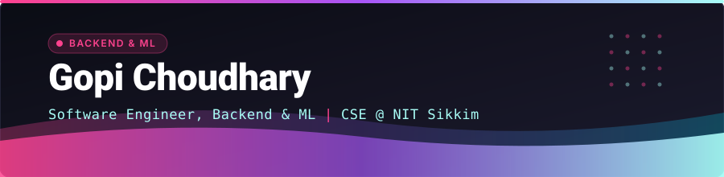
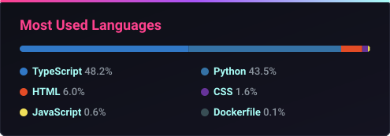

  

  
  
  
  

CSE undergraduate at NIT Sikkim. I build backend and full-stack apps (FastAPI, Next.js, Spring Boot, PostgreSQL) and applied ML projects, each with tests, CI and results measured on held-out data. Looking for SWE and ML internships.

**Stack:** Python, Java, TypeScript, SQL · FastAPI, Spring Boot, Next.js, PostgreSQL · PyTorch, scikit-learn, LightGBM, Hugging Face · Docker, GitHub Actions

---

## Featured: Intern-tracker

**[Intern-tracker](https://github.com/GopiChoudhary19/Intern-tracker)** - a full-stack platform for students to find and track internships, hackathons and scholarships.

  

- **Backend:** FastAPI + SQLAlchemy 2 + PostgreSQL, versioned REST API under `/api/v1`
- **Auth & security:** passwordless email OTP (hashed, expiring), session tokens, per-identifier rate limiting, audit logging
- **Frontend:** Next.js 14 + TypeScript + Tailwind: application pipeline, filterable opportunity feed, admin tools
- **Quality:** pytest suite and Ruff in GitHub Actions; a demo mode runs the API on an in-memory store

## Projects

| Project | What it does | Result (held-out) |
|---|---|---|
| [**hybrid-rag-qa**](https://github.com/GopiChoudhary19/hybrid-rag-qa) | BM25 (written from scratch) + dense retrieval, rank fusion, cross-encoder rerank, extractive reader over 2,067 Wikipedia passages | Recall@1 **0.740 → 0.884** from reranking; end-to-end **78.3 F1** |
| [**credit-risk-scoring**](https://github.com/GopiChoudhary19/credit-risk-scoring) | Calibrated LogReg / LightGBM with a threshold tuned on out-of-fold expected cost (default costs 5x a rejection) | Cost per applicant **0.835 → 0.545**; ROC-AUC **0.806** |
| [**fashion-cnn-gradcam**](https://github.com/GopiChoudhary19/fashion-cnn-gradcam) | Residual CNN from scratch on Fashion-MNIST, Grad-CAM error analysis, predict CLI | **93.05%** test accuracy, 392K params |
| [**Stego**](https://github.com/GopiChoudhary19/Stego) | Food pre-ordering: Spring Boot 3 / Java 17, JWT auth, Stripe with signed webhooks, WebSocket order updates, Next.js frontend | Tests + Docker builds in CI |
| [**mini-gpt-from-scratch**](https://github.com/GopiChoudhary19/mini-gpt-from-scratch) | Character-level decoder-only Transformer in PyTorch | - |
| [**ml-eval-tools**](https://github.com/GopiChoudhary19/ml-eval-tools) | CLI checks for whether a model change is a real improvement (paired per-row tests, blend checks) | - |

## Open source

- [lightgbm-org/LightGBM#7504](https://github.com/lightgbm-org/LightGBM/pull/7504) - test coverage for early stopping configured through `params` in `lgb.cv()` (awaiting review)

  

