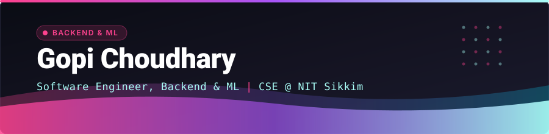
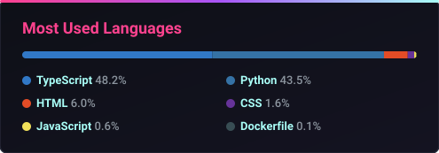
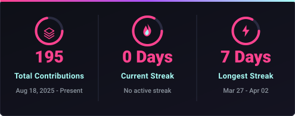

<p align="center">
  
</p>

<p align="center">
  <a href="https://github.com/GopiChoudhary19">
    
  </a>
</p>

<p align="center">
  <a href="https://gopichoudhary19.github.io/"></a>
  <a href="https://gopichoudhary19.github.io/resume.pdf"></a>
  <a href="mailto:gopigkc1910@gmail.com"></a>
  <a href="https://github.com/GopiChoudhary19"></a>
  <a href="https://www.linkedin.com/in/gopi19choudhary/"></a>
  
</p>

---

## 🧑‍💻 About Me

```yaml
name: Gopi Choudhary
role: Software Engineer (backend & full-stack) with an ML focus
institution: National Institute of Technology (NIT) Sikkim
location: India 🇮🇳
focus:
  - Backend APIs and full-stack apps (FastAPI, Next.js, PostgreSQL)
  - Testing, CI and production hygiene (pytest, GitHub Actions, Docker)
  - Retrieval & RAG systems (hybrid search, reranking, QA)
  - Applied ML with honest evaluation (CV, calibration, cost-aware decisions)
interests:
  - Transformer Architectures & LLM Fine-Tuning
  - ML Systems & MLOps
  - Full-Stack Web Development
  - Open Source Contributions
currently_learning: Advanced Deep Learning & Distributed Systems
open_to: Software Engineer internships (backend / full-stack) and ML engineering roles
```

---

## 🛠️ Tech Stack & Core Competencies

### 💻 Languages


### 🧠 AI & Machine Learning


### 🌐 Web & Backend Engineering


### ⚙️ DevOps, Cloud & Tools


---

## ⭐ Featured: Intern-tracker

**[Intern-tracker](https://github.com/GopiChoudhary19/Intern-tracker)** - a full-stack platform for students to discover and track internships, hackathons and scholarships.

<p align="center">
  <a href="https://github.com/GopiChoudhary19/Intern-tracker"></a>
</p>

- **Backend:** FastAPI + SQLAlchemy 2 + PostgreSQL, ten routers (auth, opportunities, applications, saved searches, admin ...) under `/api/v1`
- **Auth & security:** passwordless email OTP (hashed, expiring), session tokens, per-identifier rate limiting, audit logging, security headers
- **Frontend:** Next.js 14 + TypeScript + Tailwind - dashboard with an application pipeline, filterable opportunity feed, compare view, admin tools
- **Quality:** pytest API suite and Ruff in GitHub Actions; a demo mode runs the whole API on an in-memory store with no database
- **Tech:** `Next.js` `TypeScript` `FastAPI` `PostgreSQL` `SQLAlchemy` `Docker` `GitHub Actions`

---

## 🤖 Machine Learning Projects

Each project is a runnable repo with tests, CI and results measured on a held-out set.

| Project | Problem | Approach | Result |
|---|---|---|---|
| 🔎 [**hybrid-rag-qa**](https://github.com/GopiChoudhary19/hybrid-rag-qa) | Open-domain QA over 2,067 Wikipedia passages | BM25 from scratch + dense retrieval, rank fusion, cross-encoder rerank, extractive reader | Recall@1 **0.74 → 0.88** with reranking; end-to-end **78.3 F1** |
| 💳 [**credit-risk-scoring**](https://github.com/GopiChoudhary19/credit-risk-scoring) | Loan approval where a default costs 5x a rejection | Calibrated LogReg / LightGBM pipelines, threshold tuned on out-of-fold expected cost | Cost per applicant **0.835 → 0.545** vs default threshold; ROC-AUC **0.81** |
| 👕 [**fashion-cnn-gradcam**](https://github.com/GopiChoudhary19/fashion-cnn-gradcam) | Clothing image classification | Residual CNN from scratch, One-Cycle + label smoothing, Grad-CAM error analysis, CLI with heatmap output | **93.1%** test accuracy (flip TTA) with 392K params |
| 🧠 [**mini-gpt-from-scratch**](https://github.com/GopiChoudhary19/mini-gpt-from-scratch) | Character-level language modelling | Decoder-only Transformer in PyTorch | Causal self-attention, AdamW + cosine decay |
| ⚙️ [**ml-model-serving-api**](https://github.com/GopiChoudhary19/ml-model-serving-api) | Serving models in production | FastAPI + Pydantic + Docker | Containerised inference API with tests |

---

## 🌟 More

- 🧰 [**ml-eval-tools**](https://github.com/GopiChoudhary19/ml-eval-tools) - CLI utilities for checking whether a model change is a real improvement: paired per-row tests, blend checks, an experiment ledger
- 🚀 **Open source:** [lightgbm-org/LightGBM#7504](https://github.com/lightgbm-org/LightGBM/pull/7504) (open, in review) - test coverage for early stopping in `lgb.cv()`; first merged PR - [firstcontributions/first-contributions#125129](https://github.com/firstcontributions/first-contributions/pull/125129)

---

## 📊 Live GitHub Profile Stats

<p align="center">
  
  
</p>

<p align="center">
  
</p>

---

## 📬 Let's Connect

<p align="center">
  <a href="mailto:gopigkc1910@gmail.com">
    
  </a>
  <a href="https://github.com/GopiChoudhary19">
    
  </a>
  <a href="https://www.linkedin.com/in/gopi19choudhary/">
    
  </a>
</p>

<p align="center">
  
  
  
</p>
